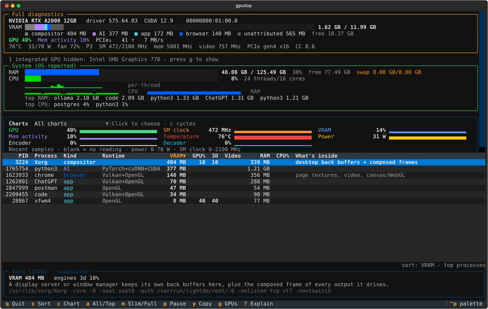
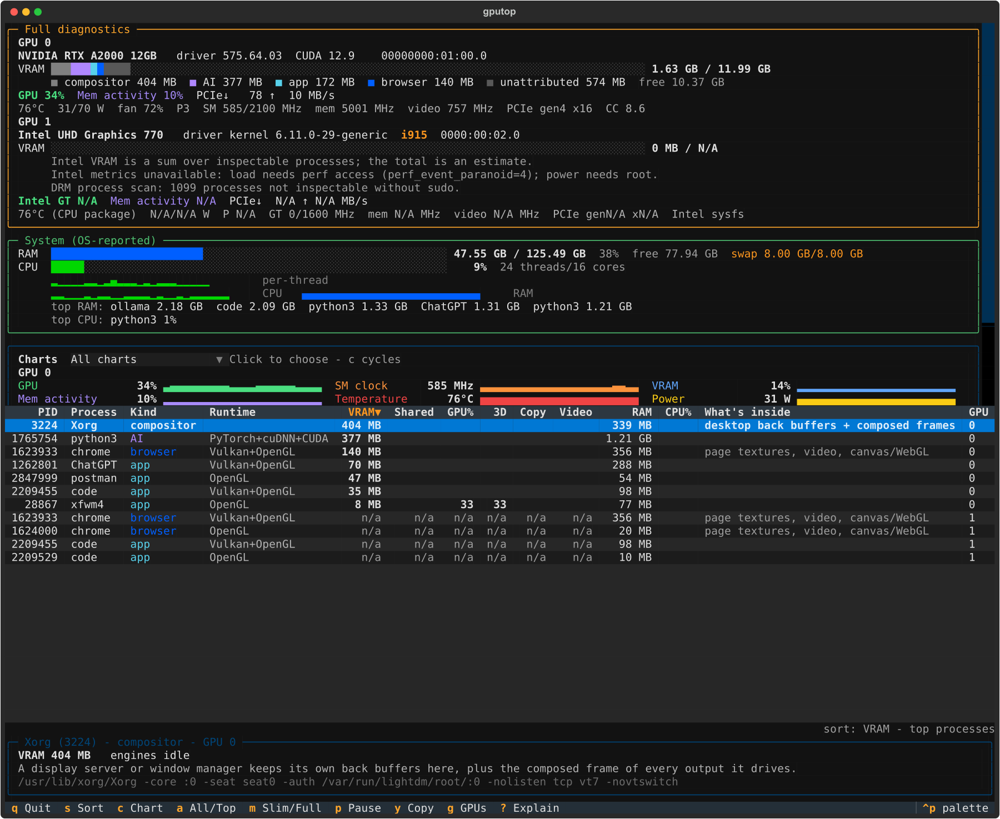

# gputop

gputop is a terminal GPU monitor for Linux. It shows what is inside your GPU: device memory,
load, temperature, power and clocks, and under that a list of the processes that hold GPU
memory, each with its VRAM, engine load, the runtime it uses (CUDA, Vulkan, llama.cpp and
others) and, when it can be told, which model it has loaded. For local LLM servers it splits the
memory of a process into weights, KV cache, compute buffers and runtime overhead. It runs as a
full-screen live view, prints a single text or JSON snapshot, records snapshots to a file, and
compares two snapshots.



With `--gpu all` the live view also shows the integrated GPU:



## Requirements

- Linux. Other platforms are not supported.
- Python 3.11 or newer.
- [uv](https://docs.astral.sh/uv/) to run it from the project directory.
- NVIDIA cards: the NVIDIA driver with its NVML library. Works natively and inside containers.
- AMD (`amdgpu`) and Intel (`i915`) cards: nothing extra. Everything is read from kernel
  interfaces (DRM fdinfo, sysfs, hwmon). Intel `xe` cards are detected, but their per-process
  memory and load show `n/a`.

## Run

From any directory, through the launcher in the project root:

```bash
/path/to/gputop/gputop
```

The launcher resolves symlinks to itself, so it can be linked into a directory on `PATH`. The
first start creates the virtual environment and installs the dependencies.

Inside the project directory this is the same:

```bash
uv run gputop
```

`main.py` runs gputop straight from the checkout without installing the package; see
[Development](#development).

A wide terminal (about 140 columns or more) is recommended for the full process table.

## Command line

```
gputop [--once] [--json] [--gpu N|all] [--list-gpus] [--no-system] [-i SECONDS]
```

| Option | Meaning |
|---|---|
| `--once` | Print one text snapshot and exit, without the live view. |
| `--json` | Print one JSON snapshot and exit (implies `--once`). |
| `--gpu N` | Show only this GPU. One-shot output defaults to GPU 0. |
| `--gpu all` | Live view only: show every GPU. By default the live view leaves out an integrated GPU when a discrete one is present and names it in one line under the GPU panels. |
| `--list-gpus` | List the selectable GPU adapters with their index, vendor and key, and exit. Adapters the live view hides by default are marked. |
| `--no-system` | Do not sample system RAM and CPU: no system panel and no RAM / CPU% columns in the live view, no system section in `--once` / `--json`. |
| `-i`, `--interval SECONDS` | Refresh interval of the live view in seconds (default 1). |
| `-h`, `--help` | Show the help text. |

Adapters are ordered NVIDIA first, then the others, each group by memory size, largest first.
An index that does not exist is rejected. One-shot output waits one second before it samples,
because load figures are rates between two readings.

### gputop diff

```
gputop diff [--json] BEFORE.json AFTER.json
```

Compares two `--json` snapshots, for example before and after loading a model. Measured
counters are compared directly; runtime-reported and estimated values are listed next to them
and are never added to the measured totals. Processes are paired by PID, then by name and
listening ports, then by a unique name; a recycled PID is never paired. Changes under 16 MB are
hidden in the text form and listed in full with `--json`. Snapshots from different adapters are
refused.

### gputop record

```
gputop record -o FILE [--gpu N] [-i SECONDS] [--duration SECONDS] [--no-system]
```

Appends one `--json` snapshot per interval to a JSON Lines file until Ctrl+C or until
`--duration` seconds have passed.

| Option | Meaning |
|---|---|
| `-o`, `--output FILE` | File to append to, one snapshot per line. Required. |
| `--gpu N` | GPU to record (default 0). |
| `-i`, `--interval SECONDS` | Seconds between samples (default 1). |
| `--duration SECONDS` | Stop after this many seconds (default: until Ctrl+C). |
| `--no-system` | Leave the system section out of the records. |

The file is only ever appended to and every line is flushed as soon as it is written, so a
recording that is interrupted or killed keeps everything written so far. Each line is a complete
snapshot: save one line to its own file and it is a valid input for `gputop diff`. Expect
roughly 27 KB per snapshot with about fifty processes, which is about 100 MB per hour at a
one-second interval.

## Keys

`q` Quit - `s` Sort - `c` Chart - `a` All/Top - `m` Slim/Full - `p` Pause - `y` Copy - `g` GPUs - `?` Explain

| Key | Action |
|---|---|
| `q` | Quit. |
| `s` | Sort the process table by the next column. The sorted column is yellow in the header and carries an arrow: `▼` largest first, `▲` A to Z. |
| `c` | Switch to the next chart mode. |
| `a` | Toggle between the busiest processes and all processes. |
| `m` | Toggle between slim monitoring and full diagnostics (display only). |
| `p` | Pause and resume sampling. |
| `y` | Copy the inspector of the selected process to the clipboard as plain text, with the whole command line (secrets stay redacted). A double click on the inspector does the same. Needs `xclip`, `xsel` or `wl-clipboard`; without them the text goes to the terminal as an OSC 52 sequence, which not every terminal accepts. |
| `g` | Show or hide the integrated GPUs that the live view leaves out by default. Present only when there is such a GPU and no single `--gpu N` was asked. |
| `?` | Open the explanation of what the numbers mean. Escape, `q` or `?` closes it. |

The arrow keys, PageUp / PageDown, Ctrl+Home / Ctrl+End and the mouse move the table cursor; the selected
process is shown in the inspector under the table. The view is read-only: there are no actions
on processes.

## What the numbers mean

Measured:

- Device totals, load, temperature, power and clocks come from NVML on NVIDIA cards and from
  sysfs / hwmon on AMD and Intel cards.
- Per-process VRAM on NVIDIA comes from NVML's compute and graphics process lists. On AMD and
  Intel it comes from DRM fdinfo, and bytes are charged to a process only when they are provably
  private to it. Otherwise the cell shows `n/a` with a reason and the bytes stay in
  "unattributed".
- Per-process load comes from NVML utilisation samples on NVIDIA and from DRM engine busy time,
  sampled twice, on AMD and Intel. `GPU%` of a process is its busiest engine.
- System RAM and CPU are reported by the operating system. They are never GPU memory and are
  never added to a GPU total.

Inferred or estimated:

- Runtimes and model files are found from the libraries and files a process has mapped and from
  its command line. A model counts as confirmed when a local server API reports it, when the
  file is mapped into the process, or when a launch flag names it.
- The split of an LLM process into weights, KV cache and compute buffers is exact when the
  runtime's own load log or server API supplies the sizes, and an estimate from the model file
  header otherwise. Each part is marked accordingly.
- Inside a container NVML reports PIDs of the host. gputop matches them to local processes: `*`
  marks a match that only one explanation fits, `?` marks an ordering guess. PIDs it cannot
  match are listed as `H:<pid>` rows and are never looked up locally.

Limits:

- There is no source on Linux for NVIDIA memory that overflowed into system RAM, or for
  committed or paged-out GPU memory on any vendor. Such values are blank or absent, never zero.
- Only processes you may inspect are listed in full; processes of other users need root. The
  DRM status line says how many could not be inspected.
- AMD: there is no device-wide video engine counter, so device encode and decode stay `N/A`.
  ROCm / HIP processes show their engines as `n/a`. On newer video hardware decode and encode
  are one `video` figure.
- Intel: device load, video load and (on integrated graphics) power need root; without it they
  show `N/A` with a reason. The memory total is an estimate or unknown, used memory is a sum
  over inspectable processes that can count shared buffers twice, and free memory is never
  shown. Memory bandwidth and the PCIe link are not available.
- Model and runtime discovery is rationed to keep the live view cheap. A newly loaded model can
  take about 15 seconds to appear.
- A reading that the driver does not expose shows `N/A` in text and `null` in JSON. That is a
  missing reading, not a fault.
- Adapters are discovered once at startup. A card that is added or removed later needs a
  restart of gputop.

## Privacy

The inspector, the JSON output and recordings contain file paths, command-line flags, model
names and local port numbers. Secrets passed as API key flags are masked in the displayed
command line, and the command line is never written to JSON. gputop only reads: it queries the
driver, `/proc`, `/sys` and local server APIs on `127.0.0.1`. Nothing leaves the machine and
model weights are never copied. Review a snapshot or recording before you share it.

## Diagnostics

gputop never writes diagnostics to the terminal. To get a log, set the environment variable
`GPUTOP_LOG_FILE` to a writable path:

```bash
GPUTOP_LOG_FILE=/tmp/gputop.log ./gputop
```

## Development

All commands run from the repository directory.

Create the project environment. `uv sync` installs the dependencies pinned in `uv.lock`
(`textual`, `psutil`, `nvidia-ml-py`) into `.venv`:

```bash
uv sync
```

Run from the activated environment:

```bash
source .venv/bin/activate
```

```bash
./main.py
```

Or run without activating it:

```bash
uv run ./main.py
```

`main.py` uses the Python that starts it, and the dependencies have to be installed in that
Python. Started with the system Python instead of the project environment it fails with
`ModuleNotFoundError: No module named 'textual'`.

To use gputop from another environment that is already activated, install it there in
editable mode together with its dependencies:

```bash
uv pip install -e .
```
